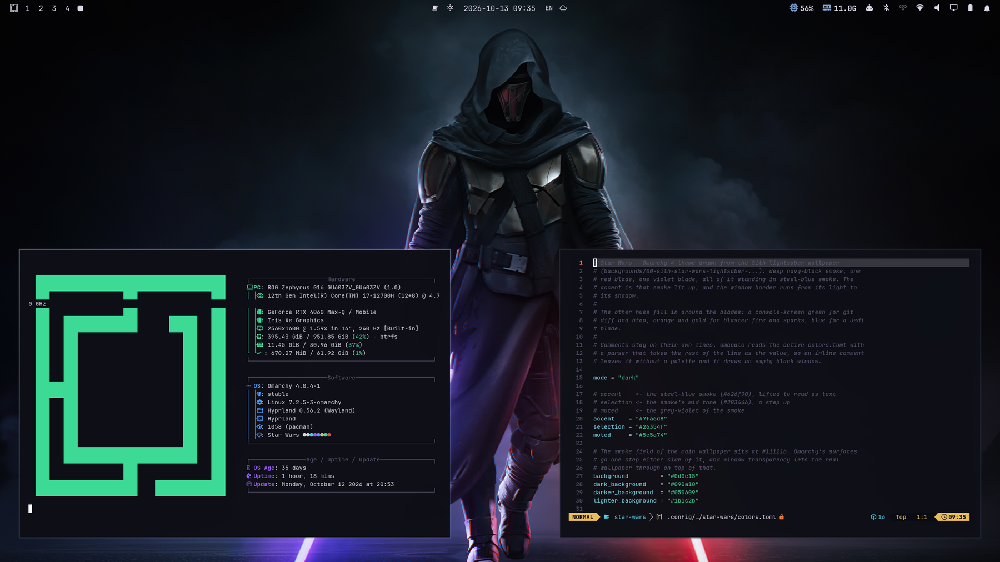
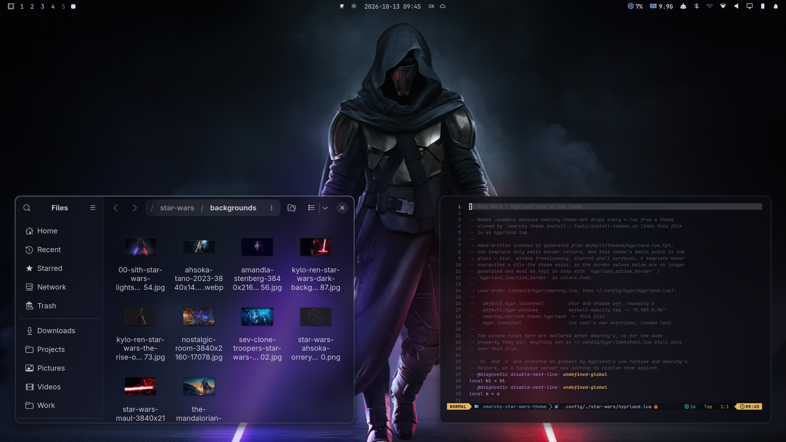
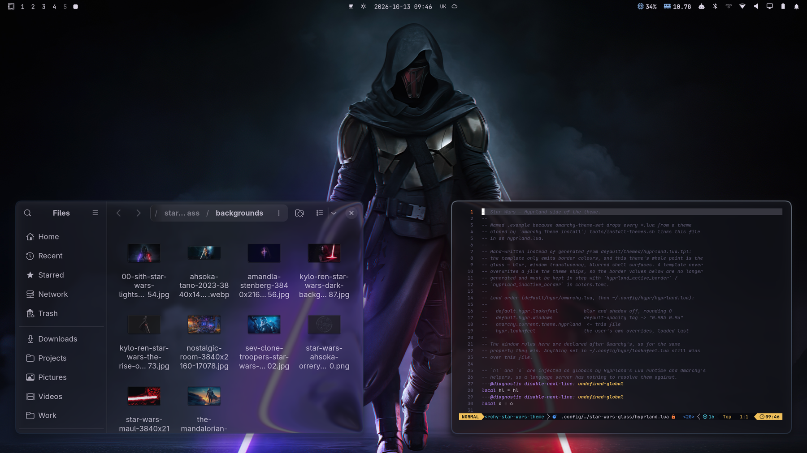

# Star Wars

An [Omarchy 4](https://omarchy.org/) theme built around a Sith lightsaber
wallpaper — navy-black smoke, one red blade, one violet blade — with frosted
glass everywhere: translucent windows, terminals, bar, menus and
notifications over a Hyprland blur.

| From `omarchy theme install` | Star Wars, full | Star Wars Glass |
|:---:|:---:|:---:|
|  |  |  |

> The wallpapers are Star Wars artwork by other people, included with credit
> to their authors — see [Backgrounds](#backgrounds). All rights stay with
> their owners; the MIT license covers only the theme's own files.

**Quick start** — the palette, the wallpapers and the shell colours, the way
the Omarchy theme gallery installs it:

```bash
omarchy theme install https://github.com/devSviat/omarchy-star-wars-theme
```

**The full theme** — the same plus the glass: blur, translucent terminals,
animations and the Star Wars Glass variant (details in [Install](#install)):

```bash
git clone https://github.com/devSviat/omarchy-star-wars-theme.git ~/Projects/omarchy-star-wars-theme
cd ~/Projects/omarchy-star-wars-theme
```

then link it into Omarchy as in [Install](#install), step 2, and
`omarchy theme set star-wars`.

[Two ways to install](#two-ways-to-install) lists exactly what each one gives
you.

## Two ways to install

| | `omarchy theme install` | Full install from a checkout |
|---|---|---|
| Palette, wallpapers, bar, icons, unlock screen | yes | yes |
| Blur, rounded glass windows, shadows, animations | no | yes |
| Terminals | opaque, generated by Omarchy from the palette | translucent over the blur |
| Menu, launcher, notifications, popups | near-opaque cards (0.94) | frosted glass (0.62 – 0.78) |
| Star Wars Glass (hyprglass) | no | yes |

A theme cloned by `omarchy theme install` is treated as untrusted: Omarchy
drops every `*.lua` and the terminal configs from it and generates its own
from `colors.toml`. Those are exactly the files that carry the blur, the
animations, the glass switch and the terminal transparency, so they are kept
here under a `.example` suffix — `hyprland.lua.example`, `foot.ini.example`
and so on — which Omarchy stages but never loads.

The full install builds each theme as a directory of symlinks into your
checkout and links every `<name>.example` in as `<name>`. That directory holds
no `.git`, so Omarchy stages it in full. The four `shell.*.toml.example` files
are the translucent menu, launcher, notification and popup cards; without a
blur behind them the window underneath shows through the text, so the plain
`shell.*.toml` files the gallery install uses are near-opaque instead.

To move from the gallery install to the full one, remove it first —
`omarchy theme remove star-wars` — then follow [Install](#install); its link
step stops if a theme directory of that name already exists.

## Two themes: Star Wars and Star Wars Glass

The full install makes this one directory two Omarchy themes, kept in
parallel:

| Theme | Slug | Glass |
|---|---|---|
| **Star Wars** | `star-wars` | Hyprland's own blur only; if hyprglass is loaded, the theme switches it off |
| **Star Wars Glass** | `star-wars-glass` | the same theme plus hyprglass liquid glass (`saber` preset) |

Every file — palette, borders, bar, terminals, wallpapers — comes from this
one directory, so the two cannot drift: `star-wars` and `star-wars-glass` are
both directories of absolute symlinks into it. The glass itself is decided at
load time in `hyprland.lua.example`, from the active theme's name in
`~/.local/state/omarchy/current/theme.name`. Change something once and both
themes have it.

Each theme has its own thumbnail in the theme switcher, linked in as
`preview.png`: `preview-full.png` and `preview-glass.png`. The repo's own
`preview.png` is the gallery install. All three are real screenshots of the
running desktop.

## Install

The full theme. Needs Omarchy 4 (Hyprland with the Lua config and the Quickshell bar); tested
on Omarchy 4.0.3 with Hyprland 0.56.2. Star Wars Glass additionally needs
the hyprglass plugin, built in step 4.

1. **Get the repo** somewhere permanent — both themes point into it, so don't
   move or delete it afterwards:

   ```bash
   git clone https://github.com/devSviat/omarchy-star-wars-theme.git ~/Projects/omarchy-star-wars-theme
   cd ~/Projects/omarchy-star-wars-theme
   ```

2. **Install both themes:**

   ```bash
   repo=$PWD
   for theme in star-wars star-wars-glass; do
     dir=$HOME/.config/omarchy/themes/$theme
     mkdir "$dir" || break
     for f in "$repo"/*; do
       name=${f##*/}
       case $name in
         CLAUDE.md | preview.png | preview-full.png | preview-glass.png) ;;
         unlock.png) cp "$f" "$dir/" ;;
         *.example) ln -s "$f" "$dir/${name%.example}" ;;
         *) [ -e "$f.example" ] || ln -s "$f" "$dir/" ;;
       esac
     done
     case $theme in
       star-wars) ln -s "$repo/preview-full.png" "$dir/preview.png" ;;
       star-wars-glass) ln -s "$repo/preview-glass.png" "$dir/preview.png" ;;
     esac
   done
   ```

   This creates `~/.config/omarchy/themes/star-wars` and
   `~/.config/omarchy/themes/star-wars-glass`, each a directory of absolute
   symlinks into the repo with its own `preview.png` — all but `unlock.png`,
   which is copied because Omarchy refuses a symlinked unlock logo. Every
   `<name>.example` is linked in as `<name>`. The links are absolute because
   Omarchy stages a theme with `cp -r`, and `.git` is left out because Omarchy
   strips every `*.lua` from a theme that holds one. Both then show up in
   Omarchy Menu → Style → Theme as **Star Wars** and **Star Wars Glass**.

3. **Apply one** — from Omarchy Menu → Style → Theme, or:

   ```bash
   omarchy theme set star-wars          # Hyprland blur only
   omarchy theme set star-wars-glass    # plus hyprglass liquid glass
   ```

   Check it came up clean: `hyprctl configerrors` should print nothing.

4. **For Star Wars Glass, build and load hyprglass.** Without the plugin,
   Star Wars Glass looks exactly like Star Wars. See
   [Liquid glass](#liquid-glass-optional-hyprglass) for the build, the
   per-session load and loading it at every login.

5. **Optional extras:**

   - *GTK apps (Files, Disks, …)* read the theme's `gtk.css` only through a
     user-level link, and only at startup:

     ```bash
     ln -sfn ~/.local/state/omarchy/current/theme/gtk.css ~/.config/gtk-4.0/gtk.css
     nautilus -q    # then reopen Files
     ```

   - *Boot splash and login screen* (the Ahsoka orrery):
     Omarchy Menu → Style → Unlock → Star Wars, or
     `omarchy-plymouth-set-by-theme star-wars` (asks for sudo, rebuilds the
     initramfs).

   - *The bar* works with its background on or off — double-click the bar to
     switch. The theme's bar tint shows only with the background on.

### Update

```bash
cd ~/Projects/omarchy-star-wars-theme
git pull
omarchy theme set star-wars-glass   # or star-wars — re-apply to stage the changes
```

The themes are links into the checkout, so a pull is enough for changed
files. If the pull adds or renames a top-level file or changes `unlock.png`,
first remove both theme directories (see [Uninstall](#uninstall)) and repeat
step 2 of [Install](#install).

After an Omarchy update that bumps Hyprland, rebuild hyprglass (see
[Liquid glass](#liquid-glass-optional-hyprglass)). Until then the old build
refuses to load and Star Wars Glass falls back to the plain look; the login
snippet below sends a notification when that happens.

### Uninstall

Switch to another theme first, then:

```bash
rm -r ~/.config/omarchy/themes/star-wars ~/.config/omarchy/themes/star-wars-glass   # links and unlock.png copies, the repo is untouched
```

If you set up the extras, also remove the hyprglass block from
`~/.config/hypr/autostart.lua`, `~/.local/share/hyprglass/`, and the
`~/.config/gtk-4.0/gtk.css` link. Then delete the repo itself.

## Palette

| Role | Value | From |
|---|---|---|
| `background` | `#0d0e15` | the smoke field of the Sith wallpaper (`#11121b`), a step down |
| `dark_background` / `darker_background` | `#090a10` / `#050609` | one and two steps below |
| `lighter_background` | `#1b1c2b` | the violet haze in the smoke |
| `foreground` | `#dcd6e6` | the pale lavender rim light on the cloak |
| `accent` | `#7fa6d8` | the steel-blue smoke (`#626f90`), lifted |
| `selection` | `#26354f` | the smoke's mid tone (`#283646`), a step up |
| active border | pale steel `#cfe0f7` 40% -> accent `#7fa6d8` 18%, 90°; inactive smoke navy `#26354f` 50%; shell rims at 85% | a glass rim lit from above, after [Velora Liquid Glass](https://github.com/shoxjaxon-atabayev/omarchy-velora-liquid-glass) |
| `green` | `#3ddc97` | a console-screen green, for `git diff` and btop |
| `orange` / `yellow` | `#ff7a3d` / `#f0c05a` | blaster fire and sparks |
| `blue` | `#4d9bff` | a Jedi blade |
| `magenta` | `#9b5cff` | the violet blade, a purer step |

## Glass

The full install. A file listed with `.example` is linked in without the
suffix.

| What | Where | Setting |
|---|---|---|
| Blur | `hyprland.lua.example` | size 9, 3 passes, brightness 0.75, vibrancy 0.25 |
| Glass edge | `hyprland.lua.example` | rim border, superellipse corners (`rounding_power 3`), shadow offset 5 px down |
| App windows | `hyprland.lua.example` | opacity 0.90 active / 0.82 inactive |
| Terminals | `foot.ini.example`, `ghostty.conf.example`, `alacritty.toml.example`, `kitty.conf.example` | background alpha 0.72 + blur requested, window 1.0 / 0.94 |
| Bar | `shell.bar.toml` | `background` at 0.7 — the windows' hue, a step deeper; needs the bar's transparent mode off |
| Menu / launcher | `shell.menu.toml.example`, `shell.launcher.toml.example` | card 0.68 / 0.62, scrim 0.1 (unblurred), selected row in the accent |
| Notifications / popups | `shell.notifications.toml.example`, `shell.popups.toml.example` | 0.72 / 0.78 |
| Polkit / tooltip / lock field | `shell.polkit.toml`, `shell.tooltip.toml`, `shell.lock.toml` | 0.85 / 0.9 / 0.55 |
| GTK apps (Files…) | `gtk.css` | rgba surfaces |

The bar has two modes, and the theme works with both: double-click the bar,
or Omarchy Menu → Style → Bar → Transparency. With its background on, the
bar is glass in the theme's tint. With it off, the bar draws no background
and sits straight on the wallpaper; the three wallpapers where a blade sat
under the icons carry a dark scrim for that (see [Backgrounds](#backgrounds)).

Terminals get alpha on the cell background rather than whole-window opacity,
so the text itself stays fully opaque. Each terminal config also asks for
blur: foot 1.28 speaks `ext-background-effect-v1`, and without `blur=yes`
it tells Hyprland not to blur behind it — translucent but sharp. Browsers,
video players, games and screen-share targets keep Omarchy's opaque rules.

Blur brightness 0.75 keeps text legible even over the bright
`nostalgic-room` wallpaper. For more see-through, lower the alpha values
above; for less, raise them.

`gtk.css` reaches GTK apps only through
`~/.config/gtk-4.0/gtk.css -> ~/.local/state/omarchy/current/theme/gtk.css`
(machine config, not part of the theme). GTK reads CSS at startup — restart
the app (`nautilus -q`) to repaint.

## Backgrounds

```
00-sith-star-wars-lightsaber-dark-background   <- default
ahsoka-tano-2023                                (3840x1468, cropped to the centre)
amandla-stenberg
kylo-ren-star-wars-dark-background-lightsaber-cosplay
kylo-ren-star-wars-the-rise-of-skywalker-black
nostalgic-room
sev-clone-troopers-star-wars-republic-commando
star-wars-ahsoka-orrery                         (from the orrery art, see Unlock screen)
star-wars-maul
the-mandalorian-season-2-tv-series-2020
```

The wallpapers come from [4kwallpapers.com](https://4kwallpapers.com/)
(names as published there), where the credits are. Ahsoka Tano 2023 is
published at 5650x2160; the copy here is scaled to 4K wide and re-encoded as
WebP, 5.7 MB down to 0.2 MB. The Ahsoka Tano 2023 art is by Andre Zottolo
and The Mandalorian season 2 edit by aggro, per the files' own metadata; the
characters and the rest are Lucasfilm's. All rights stay with their owners.

Three wallpapers — Kylo Ren with the lightsaber (cosplay), the Sev clone
trooper and Maul — carry a soft dark scrim across the top
(black at 72% under the bar, fading out by 14% of the height); the rest are
untouched. With the bar's own background off, Omarchy
picks one text colour from the *average* of the strip under it, so a dark
strip with a lightsaber in it got light text that vanished over the blade. On
those three the scrim keeps every pixel under the bar at 6.6:1 or better
against the light bar text.

Omarchy has no default-background key: on a first apply it takes the first
file in sort order, hence the `00-` prefix.

## Unlock screen

Omarchy Menu -> Style -> Unlock (the Plymouth boot splash and SDDM greeter)
uses `unlock.png`: the Ahsoka orrery, traced in a navy-grey ink so the boot
splash matches the orrery wallpaper in the rotation. Both, and the
`preview-unlock.png` for the picker, are made from the untouched Ahsoka
orrery artwork (`star-wars-ahsoka-3840x2160-12833.jpg` on
4kwallpapers.com).

## Liquid glass (optional hyprglass)

`hyprland.lua.example` carries a configuration block for the
[hyprglass](https://github.com/hyprnux/hyprglass) compositor plugin — edge
refraction, chromatic aberration and a specular sheen on windows, the bar, the
Omarchy menu and the bar panels. The block only runs when the plugin is
already loaded; without it the theme is unchanged. It follows the
[Velora Liquid Glass](https://github.com/shoxjaxon-atabayev/omarchy-velora-liquid-glass)
approach, with a softer preset of its own: `saber` inherits hyprglass's
`glass` but cuts refraction from 8.0 to 3.0, chromatic aberration from 0.5 to
0.15 and lens distortion from 0.3 to 0.12, with a thinner bezel — corners read
as rounded glass instead of a fisheye. The 0.55 alpha gate matches the blur
rules, so a menu's scrim never refracts.

Measured cost on the author's laptop (Hyprland on an RTX 4060, two high-res
monitors, 15 s per case, no other test windows open):

| Case | Hyprland CPU | GPU power |
|---|---|---|
| hyprglass off, idle | 1.1% | 9.0 W |
| hyprglass on, idle | 3.9% | 9.4 W |
| hyprglass on, a window redrawing at 30 Hz | 5.0% | 10.4 W |
| hyprglass off, a window redrawing at 30 Hz | 5.3% | 9.9 W |

That is with `live_resample` off for the shell layers (it re-rendered the
bar's glass on every clock tick and pushed idle CPU to 5.3%). What remains is
about 3% of one core and 0.5–1.5 W — small, but not free. GPU utilisation
swung too much between runs to quote. Unload it on battery if that matters.

The plugin must match the running Hyprland and its libraries exactly, and a
prebuilt release is tied to the exact build it was made on, so build it
locally. You need `make`, `g++`, `pkg-config` and Hyprland's headers
(`pkg-config --modversion hyprland` should print your Hyprland version); it
takes seconds:

```bash
git clone --depth 1 --branch v0.8.1 https://github.com/hyprnux/hyprglass ~/.local/share/hyprglass/src
git -C ~/.local/share/hyprglass/src rev-parse HEAD   # expect 725383e86a2a79457a81cdbc2ceb33c07363bd8d
make -C ~/.local/share/hyprglass/src
hyprctl plugin load ~/.local/share/hyprglass/src/hyprglass.so
hyprctl reload        # so the theme's hyprglass block runs
```

A compositor plugin runs inside Hyprland with full access to your session,
so check the commit before building: a tag can be moved, a commit hash
cannot. The hash above is the v0.8.1 this theme was tested with.

That loads it for the current session only. To load it at every login, add
this to `~/.config/hypr/autostart.lua`. It loads the plugin, reloads the
config so the theme's hyprglass block runs, and tells you when a Hyprland
update has left the build behind:

```lua
o.exec_on_start([[
f="$HOME/.local/share/hyprglass/src/hyprglass.so"
[ -f "$f" ] || exit 0
if hyprctl plugin load "$f" | grep -qx ok; then
  hyprctl reload
else
  omarchy-notification-send "hyprglass did not load" "Rebuild it for this Hyprland: make -C ~/.local/share/hyprglass/src"
fi
]])
```

The theme leaves `blur.new_optimizations` on: hyprglass sets `noblur` on the
windows and layers it glasses, so the cached blur never hides the glass.
Rebuild after every Hyprland update; a mismatched build refuses to load. To
unload: `hyprctl plugin unload ~/.local/share/hyprglass/src/hyprglass.so`.

## Animations

In the full install, `hyprland.lua.example` replaces Omarchy's animation set
with four curves:

| Curve | Feel | Used by |
|---|---|---|
| `ignite` | fast, slight overshoot — a blade snapping out | windows opening, special workspace |
| `retract` | eases in, then gone | windows closing, fade-outs |
| `glide` | long ease-out | moves, resizes, border colour, fades |
| `hyperspace` | slow start, hard jump, soft landing | workspace switches (slide + fade) |

Workspace switching is animated here, while Omarchy's defaults have it off.
The active/inactive opacity change fades, so focus moves smoothly across the
glass. The bar, the Omarchy menu and the bar panels keep Omarchy's own `no_anim`
rules: Hyprland can only move or scale a whole full-screen layer, so the
panels' motion belongs in the shell's QML, not in the theme. Anything in
`~/.config/hypr/looknfeel.lua` still wins.

## Generated from `colors.toml`

Neovim (aether), btop, Chromium, Helix, Obsidian, VS Code (a local "Omarchy"
theme), the keyboard backlight (steel blue) and the rest come from
Omarchy's own templates. Icons are `Yaru-blue-dark`.

## What installing this runs

- `omarchy theme install` runs nothing from this repo: Omarchy never loads a
  `.example` file, and the rest is colours, images and documentation.
- The full install links `hyprland.lua.example` in as `hyprland.lua`, which
  is Lua that Hyprland executes at every config load — that is how Omarchy
  themes set blur, animations and window rules, and why `omarchy theme install`
  strips `*.lua` from themes it clones. This one only sets options and rules
  and reads `~/.local/state/omarchy/current/theme.name` to pick the glass
  variant; it starts no processes. Read it before installing, as with any
  theme that ships Lua.
- The repository ships no scripts. The full install is the shell lines in
  [Install](#install), which you read and run yourself; they only create
  links and copy `unlock.png` under `~/.config/omarchy/themes/`.
- hyprglass is optional, third-party and runs inside the compositor — see
  [Liquid glass](#liquid-glass-optional-hyprglass).

## License

The theme files and documentation in this repository are under the
[MIT License](LICENSE). The wallpapers in `backgrounds/`, the unlock images
and the previews are Star Wars artwork by other people, or screenshots over
it: they are not covered by that license and stay with their owners (see
[Backgrounds](#backgrounds)).
